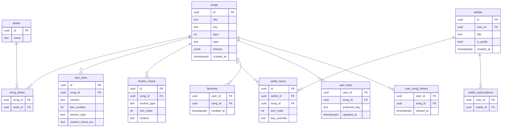
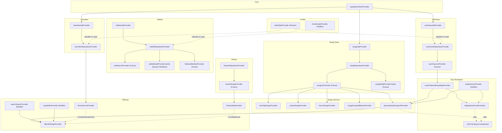

# Worship Lamal — Architecture Reference

> **Version 1.4.0+11** · Flutter 3.9.2+ · Last updated 2026-11-23

---

## 1. Tech Stack

| Concern | Package | Constraint |
|---|---|---|
| Framework | Flutter / Dart | SDK ^3.9.2 |
| State management | `flutter_riverpod` | ^3.0.3 |
| Routing | `go_router` | ^14.2.0 |
| Backend (DB, Auth, Realtime) | `supabase_flutter` | ^2.12.0 |
| Local prefs | `shared_preferences` | ^2.5.4 |
| Fonts | `google_fonts` | ^6.2.1 |
| App meta | `package_info_plus` | ^9.0.0 |
| Testing | `mocktail` / `flutter_test` | — |

---

## 2. Folder Tree

```
lib/
├── main.dart                           # Supabase.initialize, anonymous sign-in, ProviderScope
├── app.dart                            # MaterialApp.router (lightTheme only)
│
├── core/
│   ├── config/
│   │   └── supabase_config.dart        # supabaseClientProvider (Provider<SupabaseClient>)
│   ├── routing/
│   │   └── app_router.dart             # GoRouter – 5 routes (see §4)
│   ├── theme/
│   │   ├── app_colors.dart             # AppColors (Material 3 palette, section accent colors)
│   │   ├── app_constants.dart          # Font sizes, radii, spacing tokens
│   │   └── app_theme.dart              # AppTheme.lightTheme / darkTheme (dark unused)
│   └── utils/
│       ├── chord_parser.dart           # ChordParser.parse(line) → List<ChordChunk>
│       ├── key_transposer.dart         # KeyTransposer.transpose(key, semitones)
│       ├── music_theory.dart           # MusicTheory (chromaticScale, enharmonicAliases, normalizeNote)
│       └── nashville_helper.dart       # NashvilleHelper.translate(nashvilleChord, keyRoot)
│
├── shared/widgets/
│   ├── app_scaffold.dart               # Shared layout scaffold
│   └── empty_state.dart                # Generic empty-state placeholder
│
└── features/
    ├── songs/        ← barrel: songs_feature.dart
    │   ├── data/
    │   │   ├── models/
    │   │   │   ├── song_model.dart       # Song, Artist, SectionBlock, SongType enum, SongUi ext
    │   │   │   ├── lyric_line_model.dart  # LyricLine (id, content, line_number, section_type, content_chord_pro)
    │   │   │   ├── rhythm_chart_model.dart# RhythmChart (id, songId, sectionType, sortOrder, content)
    │   │   │   └── song_sort_option.dart  # SongSortOption enum (titleAz, newest, recentlyViewed)
    │   │   ├── remote/
    │   │   │   └── songs_api.dart         # SongsApi – fetchSongs(), fetchSongById()
    │   │   └── repositories/
    │   │       ├── songs_repository.dart   # Thin pass-through to SongsApi
    │   │       ├── auth_repository.dart    # signIn/Up/Out, upgradeGuestAccount
    │   │       └── history_repository.dart # addToHistory, getRecentSongs (user_song_history)
    │   └── presentation/
    │       ├── providers/
    │       │   ├── song_provider.dart       # songsApi → songRepository → songList → personalized → type shelves
    │       │   ├── display_key_provider.dart # displayKeyProvider.family – key priority resolver
    │       │   ├── song_filter_provider.dart # SongFilterNotifier, SearchQueryNotifier, filteredSongsProvider
    │       │   └── history_provider.dart     # historyRepository, recentSongs, historyController
    │       ├── screens/
    │       │   ├── home_screen.dart          # 4-tab NavigationBar (Home, Songs, Setlists, Profile)
    │       │   ├── home_dashboard_tab.dart   # Discovery shelves (Worship, Praise, Hymns, By Key)
    │       │   ├── song_list_tab.dart        # Searchable filterable song list
    │       │   ├── song_detail_screen.dart   # Lyric/Chord mode switch + zoom controls
    │       │   ├── song_results_screen.dart  # Search results screen
    │       │   └── chord_mode_view.dart      # Dual-path: Rhythm grid vs Legacy lyric+chord
    │       ├── widgets/
    │       │   ├── chord_line_renderer.dart   # ChordPro line → chord-above-lyric Wrap widget
    │       │   ├── rhythm_bar_renderer.dart   # Nashville bar-line → piped chord row
    │       │   ├── lyric_section_widget.dart   # Lyric section rendering
    │       │   ├── song_header.dart            # Song title/artist/key header
    │       │   ├── song_list_item.dart         # Song list row
    │       │   ├── song_search_field.dart       # Search text field
    │       │   ├── song_filter_bottom_sheet.dart# Filter UI bottom sheet
    │       │   └── add_to_setlist_sheet.dart    # Add song to setlist modal
    │       └── utils/
    │           └── apply_song_filter.dart       # applyFilterAndSort() pure function
    │
    ├── setlists/     ← barrel: setlists_feature.dart
    │   ├── data/
    │   │   ├── models/
    │   │   │   └── setlist_model.dart      # Setlist, SetlistItem (nests Song)
    │   │   ├── remote/
    │   │   │   └── setlists_api.dart       # CRUD, follow/unfollow, reorder, realtime RPC
    │   │   └── repositories/
    │   │       └── setlist_repository.dart  # Thin pass-through
    │   └── presentation/
    │       ├── providers/
    │       │   ├── setlist_provider.dart        # SetlistController (AsyncNotifier), realtime StreamProvider
    │       │   ├── song_picker_providers.dart   # Picker-specific providers
    │       │   └── song_filter_logic.dart       # Picker filter logic
    │       └── screens/
    │           ├── setlists_tab.dart             # Setlist list (owned + followed)
    │           ├── setlist_details/
    │           │   ├── screen.dart               # SetlistDetailScreen
    │           │   ├── header.dart               # Setlist header
    │           │   ├── item_card.dart            # Song row in setlist
    │           │   ├── key_picker_dialog.dart    # Key override picker
    │           │   ├── song_picker_screen.dart   # Add songs to setlist
    │           │   ├── setlist_owner_view.dart   # Owner controls (edit, reorder, delete)
    │           │   ├── setlist_viewer_view.dart  # Read-only follower view
    │           │   ├── setlist_share_sheet.dart  # Share sheet
    │           │   └── empty.dart               # Empty setlist state
    │           └── widgets/
    │               ├── create_setlist_dialog.dart
    │               ├── setlist_card.dart
    │               ├── setlist_section_header.dart
    │               ├── empty_setlist_state.dart
    │               └── song_picker_item.dart
    │
    ├── favorites/    ← barrel: favorites_feature.dart  ⚠️ DO NOT REFACTOR — treat as passive filter only
    │   ├── data/
    │   │   ├── model/favorite_model.dart
    │   │   ├── remote/favorites_api.dart
    │   │   └── repositories/favorites_repository.dart
    │   └── presentation/providers/favorites_provider.dart
    │
    ├── userkey/      ← barrel: userkey_feature.dart
    │   ├── data/
    │   │   ├── model/user_key_model.dart       # UserKey (userId, songId, preferredKey)
    │   │   ├── remote/user_keys_api.dart       # fetch, set (upsert), delete
    │   │   └── repositories/user_keys_repository.dart
    │   └── presentation/providers/user_keys_provider.dart  # userPreferredKeysMapProvider, UserKeyController
    │
    └── profile/      ← barrel: profile_feature.dart
        └── presentation/
            ├── providers/
            │   ├── auth_provider.dart           # authStateProvider (StreamProvider<AuthState>)
            │   ├── preferences_provider.dart    # PreferencesNotifier (VocalMode, ContentMode), ChordScaleNotifier
            │   └── shared_preferences.dart      # PreferencesService (read/write to SharedPreferences)
            └── screens/
                ├── profile_tab.dart
                ├── login_screen.dart
                ├── signup_screen.dart
                └── changelog_screen.dart
```

---

## 3. Supabase Data Model

### Entity-Relationship Diagram



### Key Queries

| API Class | Method | Tables Touched | Notes |
|---|---|---|---|
| `SongsApi.fetchSongs()` | `songs` + nested `song_artists→artists`, `lyric_lines`, `rhythm_charts` | Full eager load, rhythm_charts ordered by sort_order |
| `SongsApi.fetchSongById(id)` | Same joins, filtered `.eq('id', id).single()` | |
| `SetlistsApi.fetchSetlists()` | `setlists` + nested `setlist_items→songs→song_artists→artists` | Filtered by `user_id` |
| `SetlistsApi.fetchSetlistById(id)` | Same, `.maybeSingle()` | Returns `null` if not found |
| `SetlistsApi.getFollowedSetlists()` | `setlist_subscriptions` → `setlists` → items → songs | Reverse join through subscriptions |
| `FavoritesApi.fetchUserFavorites(uid)` | `favorites` + nested `songs→song_artists→artists` | Ordered by `created_at` desc |
| `UserKeysApi.fetchUserKeys(uid)` | `user_keys` filtered by `user_id` | Returns flat list |
| `HistoryRepository.getRecentSongs(uid)` | `user_song_history` → `songs` + nested relations | Limit 20, ordered by `viewed_at` desc |

### Realtime

`setlistDetailProvider` opens a Supabase Realtime channel on `setlist_items` filtered by `setlist_id`. On any `INSERT/UPDATE/DELETE`, it re-fetches the full setlist. The channel is disposed via `ref.onDispose()`.

### RPC

`SetlistsApi.deleteAndNormalize()` calls the Postgres function `delete_setlist_item_and_normalize(target_item_id, target_setlist_id)`.

---

## 4. Routing

```
GoRouter (initialLocation: '/')
│
├── /                           → HomeScreen (4-tab: Dashboard, Songs, Setlists, Profile)
├── /song/:id                   → SongDetailScreen(songId, ?setlistId)
│       query: ?setlistId       — when present, reads key_override from setlist
├── /setlist/:id                → SetlistDetailScreen(setlistId, ?auto_follow)
│       query: ?auto_follow     — auto-follows if 'true'
├── /song-picker                → SongPickerScreen(existingSongIds via state.extra)
└── /results                    → SongResultsScreen
```

All routes are flat children of `/`. No nested navigation or shell routes. `HomeScreen` manages tab switching via `setState` (not GoRouter).

---

## 5. Riverpod Provider Graph



### Key Priority (displayKeyProvider)

```
1. User-set preferred key     → userPreferredKeysMapProvider[songId]
2. Female vocal transposition  → KeyTransposer.transpose(originalKey, -5)   (if VocalMode.female)
3. Original key from DB        → song.key ?? 'Unknown'
```

### personalizedSongListProvider

Clones every `Song` with the resolved effective key baked in, so downstream consumers always see the user's preferred key without re-resolving.

---

## 6. Core Utilities — Chord & Key System

### MusicTheory

**Location:** `core/utils/music_theory.dart`
**Purpose:** Single source of truth for the 12-tone chromatic scale and enharmonic alias normalization.

- 12-note chromatic scale using worship-common enharmonics (C, C#, D, Eb, E, F, F#, G, Ab, A, Bb, B)
- Normalizes enharmonic inputs (Cb→B, Db→C#, D#→Eb, Gb→F#, G#→Ab, A#→Bb)
- Static helper: `normalizeNote(String note) → String`

### KeyTransposer

**Location:** `core/utils/key_transposer.dart`
**Purpose:** Transpose a note name by N semitones around the chromatic scale.

- Uses `MusicTheory.chromaticScale` and `MusicTheory.normalizeNote`
- Pure static method: `transpose(String key, int semitones) → String`

### NashvilleHelper

**Location:** `core/utils/nashville_helper.dart`
**Purpose:** Convert Nashville Number System chords (1, 4m, 5, b7) into letter chords relative to a key root.

- Uses `MusicTheory.chromaticScale` and `MusicTheory.normalizeNote`
- Major-scale intervals map: `{1:0, 2:2, 3:4, 4:5, 5:7, 6:9, b7:10, 7:11}`
- Regex replaces all `b7` and `[1-7]` tokens with the computed note
- Strips `m` from key root before resolving (supports minor keys)

### ChordParser

**Location:** `core/utils/chord_parser.dart`
**Purpose:** Parse ChordPro-style bracket notation `[G]Amazing [C]Grace` into typed chunks.

- Splits on `[`, extracts chord between `[` and `]`, remainder becomes lyric text
- Returns `List<ChordChunk>` where each chunk has `chord: String?` and `text: String`

---

## 7. Chord / Rhythm Rendering Pipeline

```
SongDetailScreen
│
├── isChordMode? ──(yes)──→ ChordModeView
│                              │
│                              ├── hasRhythmCharts? ──(yes)──→ _buildRhythmGridColumns()
│                              │                                 │
│                              │                                 ├── _getRhythmSections()
│                              │                                 │     Groups RhythmChart by sectionType
│                              │                                 │     Sorts by sortOrder
│                              │                                 │     → List<RhythmSectionBlock>
│                              │                                 │
│                              │                                 ├── _balanceRhythmColumns()
│                              │                                 │     Distributes sections across 1 or 2 columns
│                              │                                 │     by estimated height
│                              │                                 │
│                              │                                 └── RhythmBarRenderer (per chart)
│                              │                                       Splits barLine on '|'
│                              │                                       Per measure: splits on whitespace
│                              │                                       Each chord → NashvilleHelper.translate(chord, targetKey)
│                              │                                       Rendered in GoogleFonts.patrickHand
│                              │
│                              └── hasRhythmCharts? ──(no)──→ _buildLegacyLyricColumns()
│                                                               │
│                                                               ├── song.sections (computed getter)
│                                                               │     Groups LyricLine by sectionType → SectionBlock
│                                                               │
│                                                               ├── _balanceColumns()
│                                                               │     Same algorithm as rhythm (duplicated — §8 smell #5)
│                                                               │
│                                                               └── ChordLineRenderer (per line)
│                                                                     ChordParser.parse(line) → ChordChunk[]
│                                                                     Each chord → NashvilleHelper.translate(chord, targetKey)
│                                                                     Renders chord-above-lyric via Column in Wrap
│                                                                     Groups into word-units to prevent mid-word breaks
│
└── isChordMode? ──(no)──→ _LyricModeView
                              Uses song.sections
                              Color-coded section cards (chorus=green, bridge=amber, pre-chorus=indigo)
                              Plain text lyrics (no chords rendered)
```

### Zoom / Scale

`chordScaleProvider` (Notifier, default 1.0, clamped 0.7–2.5) drives:
- Font sizes in both ChordModeView and _LyricModeView (multiplied by scaleFactor)
- Padding/margins (multiplied by scaleFactor)
- Pinch-to-zoom gesture in ChordModeView (`GestureDetector.onScaleUpdate`)
- AppBar zoom pill (+/−/reset) in SongDetailScreen

---

## 8. Architectural Smells & Tight Coupling

### Smell 1 — Hardcoded Supabase Credentials
**File:** [`main.dart`](file:///d:/Programming/Projects/worship_lamal/lib/main.dart#L12-L14)
The Supabase URL and anon key are inline string constants. The `.env` file is registered as a Flutter asset but never loaded via `flutter_dotenv`.

### Smell 3 — AuthRepository Bypasses DI
**File:** [`auth_repository.dart`](file:///d:/Programming/Projects/worship_lamal/lib/features/songs/data/repositories/auth_repository.dart#L4)
Hard-codes `Supabase.instance.client` instead of accepting an injected `SupabaseClient`. Also lives under `features/songs/` despite being a cross-cutting auth concern.

### Smell 4 — HistoryRepository and UserKeysRepository Inconsistent DI
**Files:** [`history_repository.dart`](file:///d:/Programming/Projects/worship_lamal/lib/features/songs/data/repositories/history_repository.dart), [`user_keys_repository.dart`](file:///d:/Programming/Projects/worship_lamal/lib/features/userkey/data/repositories/user_keys_repository.dart#L10-L16), [`favorites_repository.dart`](file:///d:/Programming/Projects/worship_lamal/lib/features/favorites/data/repositories/favorites_repository.dart#L11-L17)
`HistoryRepository` takes `SupabaseClient` via constructor (good), but `UserKeysRepository` and `FavoritesRepository` access `Supabase.instance.client.auth.currentUser` directly for the user ID.

### Smell 6 — Cross-Feature Provider Imports
**File:** [`song_filter_provider.dart`](file:///d:/Programming/Projects/worship_lamal/lib/features/songs/presentation/providers/song_filter_provider.dart#L6)
`filteredSongsProvider` directly watches `favoritesListProvider` (from `features/favorites/`) and `historyMapProvider` (same feature, but tightly coupled). This violates the stated rule that features should not cross-import providers.

---

## 9. Feature-Driven Architecture Blueprint

### Core Principle

Each feature is self-contained: it owns its models, API layer, repositories, providers, screens, and widgets. Cross-feature communication uses only:

1. **Navigation** — GoRouter, passing minimal data (IDs, not objects)
2. **Barrel exports** — `*_feature.dart` files expose the public API
3. **Core services** — shared Supabase client, theme, routing via `core/`

### Data Flow (Sacred Rule)

```
UI Widget → Provider (Riverpod) → Repository → API / Local Storage
```

Never skip a layer. Never go backwards. No repository calls from widgets. No provider reads from other features' providers — use their `*_feature.dart` exports for models only.

### Hard Constraints

1. **`features/favorites/`** — Do NOT refactor. Treat as a passive filter. Leave current implementation as-is until explicit instructions are given.
2. **No circular dependencies** — Feature A may import Feature B's models (via barrel), never its providers or repositories.
3. **Use `git mv`** when moving files to preserve history.
4. **Providers are state machines** — single responsibility. Use `.family` for parameterized providers.
5. **Widgets stay dumb** — accept data via constructor, no direct repository access.

### Naming Conventions

| Kind | Pattern | Example |
|---|---|---|
| Provider | `${feature}Provider` | `songListProvider` |
| Filter provider | `${feature}FilterProvider` | `songFilterProvider` |
| Controller | `${Feature}Controller` | `SetlistController` |
| Repository | `${Feature}Repository` | `SongsRepository` |
| Screen | `${Feature}Screen` | `SongDetailScreen` |
| Widget | `${Feature}Card` / `${Feature}Item` | `SetlistCard` |
| Model | `${Feature}` (no suffix) | `Song`, `Setlist` |
| Barrel | `${feature}_feature.dart` | `songs_feature.dart` |

### Commit Messages

```
refactor: migrate {feature} to feature-driven architecture
feat: add {feature} barrel exports
fix: resolve cross-feature import in {file}
docs: update architecture reference
```

---

## 10. Migration Checklist

- [x] Create `*_feature.dart` barrel exports for setlists, profile, favorites, userkey
- [ ] Move `auth_repository.dart` from `features/songs/` to `features/profile/` (or `core/services/`)
- [x] Extract shared chromatic scale from KeyTransposer + NashvilleHelper into `core/utils/music_theory.dart`
- [x] Extract generic `balanceColumns<T>()` from ChordModeView
- [ ] Load Supabase credentials from `.env` via `flutter_dotenv`
- [x] Remove orphaned `_showTextSettingsSheet` from song_detail_screen.dart
- [x] Audit and remove or implement `songs_dao.dart`
- [ ] Break cross-feature provider import (filteredSongsProvider → favoritesListProvider)
- [x] Add namespace collision guard for realtime channel names
- [ ] Standardize DI: all repositories should accept `SupabaseClient` via constructor
